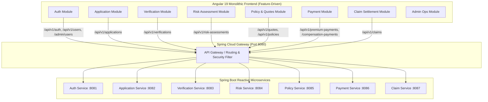
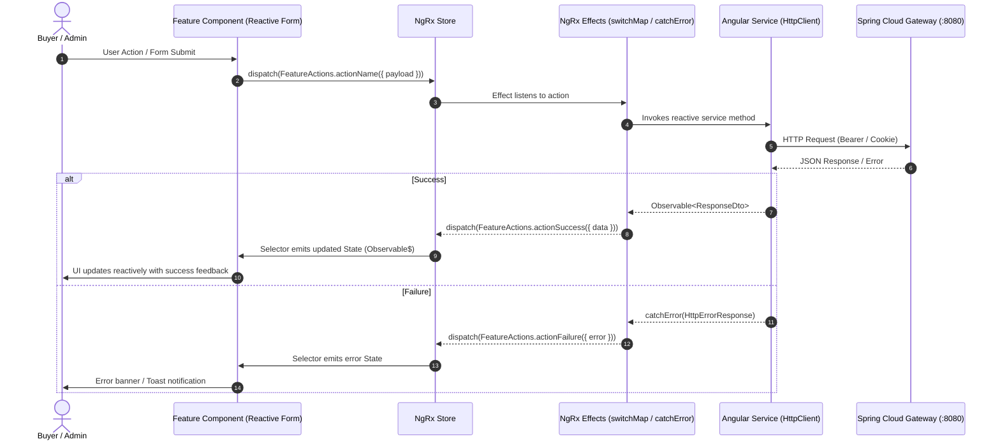

# Real Estate Project Delay Insurance Platform - Complete Architecture & API Specification

## 1. Executive System Overview

The **Real Estate Project Delay Insurance Platform** provides end-to-end insurance lifecycle management for homebuyers whose properties encounter construction and handover delays. Built as a distributed microservices ecosystem behind an API Gateway with an Angular Frontend, the platform automates application onboarding, property verification, risk analysis, dynamic quote generation, premium escrow/payments, policy issuance, delay claim adjudication, and compensation settlements.



---

## 2. Microservices Architecture & Endpoints Analysis

### 2.1 API Gateway Route Mapping (`Port 8080`)
| Route ID | Path Predicate | Target Service | Discovery URI |
| :--- | :--- | :--- | :--- |
| `auth-service` | `/api/v1/auth/**` | Auth Service | `lb://AUTH-SERVICE` |
| `auth-user-service` | `/api/v1/users/**` | Auth Service | `lb://AUTH-SERVICE` |
| `auth-admin-service` | `/admin/**` | Auth Service | `lb://AUTH-SERVICE` |
| `application-service` | `/api/v1/applications/**` | Application Service | `lb://APPLICATION-SERVICE` |
| `verification-service` | `/api/v1/verifications/**` | Verification Service | `lb://VERIFICATION-SERVICE` |
| `risk-service` | `/api/v1/risk-assessments/**` | Risk Service | `lb://RISK-SERVICE` |
| `policy-quotes-short-service` | `/quotes/**` | Policy Service | `lb://POLICY-SERVICE` |
| `policy-quotes-service` | `/api/v1/quotes/**` | Policy Service | `lb://POLICY-SERVICE` |
| `policy-service` | `/api/v1/policies/**` | Policy Service | `lb://POLICY-SERVICE` |
| `premium-payment-service` | `/api/v1/premium-payments/**` | Payment Service | `lb://PAYMENT-SERVICE` |
| `compensation-payment-service` | `/api/v1/compensation-payments/**` | Payment Service | `lb://PAYMENT-SERVICE` |
| `payment-webhook-service` | `/api/v1/payment-webhooks/**` | Payment Service | `lb://PAYMENT-SERVICE` |
| `claim-service` | `/api/v1/claims/**` | Claim Service | `lb://CLAIM-SERVICE` |

---

### 2.2 Microservice-by-Microservice Endpoint & DTO Specification

#### 1. Auth Service
* **Base Path**: `/api/v1/auth`, `/api/v1/users`, `/admin`
* **Roles**: `BUYER`, `ADMIN`

| Method | Endpoint | Allowed Roles | Request DTO | Response DTO | Description |
| :--- | :--- | :--- | :--- | :--- | :--- |
| `POST` | `/api/v1/auth/register` | Public | `RegisterRequest` | `RegisterResponse` | Register a new user |
| `POST` | `/api/v1/auth/login` | Public | `LoginRequest` | `LoginResponse` + Cookie | Login & issue JWT token cookie |
| `POST` | `/api/v1/auth/logout` | Public/Auth | None | Empty (204) | Logout & clear JWT cookie |
| `GET` | `/api/v1/users/me` | `BUYER` | None | `UserProfileResponse` | Fetch current user profile |
| `PUT` | `/api/v1/users/me` | `BUYER` | `UpdateProfileRequest` | `UserProfileResponse` | Update current user profile |
| `GET` | `/admin/users` | `ADMIN` | None | `UserProfileResponse[]` | List all users for administration |
| `PATCH` | `/admin/users/{userId}/status` | `ADMIN` | `UserStatusUpdateRequest` | `User` | Activate/suspend user account |

##### DTO Mapping:
* **RegisterRequest**: `{ firstName: string, lastName: string, email: string, mobileNumber: string, password: string }`
* **RegisterResponse**: `{ userId: string, message: string }`
* **LoginRequest**: `{ email: string, password: string }`
* **LoginResponse**: `{ message: string, role: string, token?: string }`
* **UserProfileResponse**: `{ userId: string, firstName: string, lastName: string, email: string, mobileNumber: string, role: string, status: string }`
* **UpdateProfileRequest**: `{ firstName: string, lastName: string, mobileNumber: string }`
* **UserStatusUpdateRequest**: `{ status: 'ACTIVE' | 'SUSPENDED' | 'INACTIVE', reason?: string }`

---

#### 2. Application Service
* **Base Path**: `/api/v1/applications`
* **Roles**: `BUYER`, `ADMIN`

| Method | Endpoint | Allowed Roles | Request DTO | Response DTO | Description |
| :--- | :--- | :--- | :--- | :--- | :--- |
| `POST` | `/api/v1/applications` | `BUYER` | `CreateApplicationRequest` | `Application` | Create insurance application |
| `GET` | `/api/v1/applications` | `BUYER` | None | `Application[]` | Get logged-in buyer's applications |
| `GET` | `/api/v1/applications/all` | `ADMIN` | None | `Application[]` | Get all system applications |
| `GET` | `/api/v1/applications/{applicationId}` | `BUYER`, `ADMIN` | None | `Application` | Fetch application details |
| `PUT` | `/api/v1/applications/{applicationId}` | `BUYER` | `CreateApplicationRequest` | `Application` | Update draft application |
| `PATCH` | `/api/v1/applications/{applicationId}/status` | `ADMIN` | `ApplicationStatusUpdateRequest` | `Application` | Update application status |
| `POST` | `/api/v1/applications/{applicationId}/submit` | `BUYER` | None | `Application` | Submit application for verification |
| `POST` | `/api/v1/applications/{applicationId}/withdraw` | `BUYER` | None | `Application` | Buyer withdraws application |
| `GET` | `/api/v1/applications/{applicationId}/documents` | `BUYER`, `ADMIN` | None | `ApplicationDocument[]` | Retrieve uploaded documents |
| `POST` | `/api/v1/applications/{applicationId}/documents` | `BUYER` | `UploadDocumentRequest` | `ApplicationDocument` | Attach document metadata |

##### DTO Mapping:
* **CreateApplicationRequest**: `{ builderName: string, projectName: string, unitNumber: string, propertyValue: number, purchaseDate: string, promisedPossessionDate: string }`
* **Application**: `{ applicationId: string, userId: number, builderName: string, projectName: string, unitNumber: string, propertyValue: number, purchaseDate: string, promisedPossessionDate: string, status: ApplicationStatus }`
* **UploadDocumentRequest**: `{ documentType: string, fileName: string, filePath: string }`
* **ApplicationDocument**: `{ documentId: string, applicationId: string, documentType: string, fileName: string, filePath: string, reviewStatus: string }`
* **ApplicationStatus**: `'DRAFT' | 'SUBMITTED' | 'VERIFICATION_IN_PROGRESS' | 'ADDITIONAL_INFORMATION_REQUIRED' | 'VERIFIED' | 'REJECTED' | 'WITHDRAWN'`

---

#### 3. Verification Service
* **Base Path**: `/api/v1/verifications`
* **Roles**: `BUYER`, `ADMIN`

| Method | Endpoint | Allowed Roles | Request DTO | Response DTO | Description |
| :--- | :--- | :--- | :--- | :--- | :--- |
| `GET` | `/api/v1/verifications/applications` | `ADMIN` | None | `ApplicationResponse[]` | Get applications pending verification |
| `GET` | `/api/v1/verifications/applications/{applicationId}` | `BUYER`, `ADMIN` | None | `VerificationRecord` | Get verification status & notes |
| `POST` | `/api/v1/verifications/applications/{applicationId}/property-verification` | `ADMIN` | `PropertyVerificationRequest` | `VerificationRecord` | Verify physical/legal property |
| `POST` | `/api/v1/verifications/applications/{applicationId}/request-information` | `ADMIN` | `AdditionalInfoRequest` | `VerificationRecord` | Request additional buyer documents |
| `POST` | `/api/v1/verifications/applications/{applicationId}/approve` | `ADMIN` | `ApprovalRequest` | `VerificationRecord` | Final verification approval |
| `POST` | `/api/v1/verifications/applications/{applicationId}/reject` | `ADMIN` | `RejectVerificationRequest` | `VerificationRecord` | Reject application verification |

##### DTO Mapping:
* **VerificationRecord**: `{ verificationId: string, applicationId: string, verificationStatus: VerificationStatus, remarks: string, verifiedBy: string, verifiedAt: string }`
* **PropertyVerificationRequest**: `{ remarks: string, verifiedBy: string }`
* **AdditionalInfoRequest**: `{ remarks: string, requestedBy: string }`
* **ApprovalRequest**: `{ remarks: string, approvedBy: string }`
* **RejectVerificationRequest**: `{ remarks: string, rejectedBy: string }`
* **VerificationStatus**: `'PENDING' | 'PROPERTY_VERIFIED' | 'ADDITIONAL_INFORMATION_REQUIRED' | 'VERIFIED' | 'REJECTED'`

---

#### 4. Risk Assessment Service
* **Base Path**: `/api/v1/risk-assessments`
* **Roles**: `BUYER`, `ADMIN`

| Method | Endpoint | Allowed Roles | Request DTO | Response DTO | Description |
| :--- | :--- | :--- | :--- | :--- | :--- |
| `POST` | `/api/v1/risk-assessments` | `ADMIN` | `RiskAssessmentRequest` | `RiskAssessment` | Calculate multi-factor risk score |
| `GET` | `/api/v1/risk-assessments/applications/{applicationId}/risk-assessment` | `BUYER`, `ADMIN` | None | `RiskAssessment` | Get risk assessment details |
| `POST` | `/api/v1/risk-assessments/{assessmentId}/approve` | `ADMIN` | `ApproveRiskRequest` | `RiskAssessment` | Approve risk score & multiplier |
| `POST` | `/api/v1/risk-assessments/{assessmentId}/decline` | `ADMIN` | `DeclineRiskRequest` | `RiskAssessment` | Decline high-risk project |

##### DTO Mapping:
* **RiskAssessmentRequest**: `{ applicationId: string, assessedBy: string, builderScore: number, financialScore: number, projectProgressScore: number, locationScore: number, approvalScore: number }`
* **RiskAssessment**: `{ assessmentId: string, applicationId: string, riskScore: number, riskCategory: 'LOW' | 'MEDIUM' | 'HIGH', premiumMultiplier: number, remarks: string, status: 'PENDING' | 'APPROVED' | 'DECLINED', assessedBy: string, assessedAt: string }`
* **ApproveRiskRequest**: `{ remarks: string, assessedBy: string }`
* **DeclineRiskRequest**: `{ remarks: string, assessedBy: string }`

---

#### 5. Policy Service
* **Base Path**: `/api/v1/quotes`, `/api/v1/policies`
* **Roles**: `BUYER`, `ADMIN`

| Method | Endpoint | Allowed Roles | Request DTO | Response DTO | Description |
| :--- | :--- | :--- | :--- | :--- | :--- |
| `POST` | `/api/v1/quotes/applications/{applicationId}` | `ADMIN` | `GenerateQuoteRequest` | `Quote[]` | Generate 3 insurance quote tiers |
| `GET` | `/api/v1/quotes/applications/{applicationId}` | `BUYER`, `ADMIN` | None | `Quote[]` | Get generated quotes |
| `GET` | `/api/v1/quotes/{quoteId}` | `BUYER`, `ADMIN` | None | `Quote` | Get quote by ID |
| `POST` | `/api/v1/quotes/{quoteId}/accept` | `BUYER` | None | `Quote` | Buyer accepts quote plan |
| `POST` | `/api/v1/quotes/{quoteId}/decline` | `BUYER` | None | `Quote` | Buyer declines quote |
| `POST` | `/api/v1/policies` | `ADMIN` | `CreatePolicyRequest` | `Policy` | Create policy upon payment |
| `GET` | `/api/v1/policies` | `ADMIN` | None | `Policy[]` | List all issued policies |
| `GET` | `/api/v1/policies/{policyId}` | `BUYER`, `ADMIN` | None | `Policy` | Get policy details |
| `POST` | `/api/v1/policies/{policyId}/complete` | `ADMIN` | None | `Policy` | Complete policy upon handover |
| `POST` | `/api/v1/policies/{policyId}/close` | `ADMIN` | None | `Policy` | Close expired policy |

##### DTO Mapping:
* **GenerateQuoteRequest**: `{ applicationId: string, baseCoverageAmount: number, planTypes?: string[] }`
* **Quote**: `{ quoteId: string, applicationId: string, planName: string, premiumAmount: number, monthlyCompensation: number, maximumDelayMonths: number, maximumPayout: number, gracePeriodDays: number, expiryDate: string, status: 'GENERATED' | 'ACCEPTED' | 'DECLINED' | 'EXPIRED', createdAt: string }`
* **CreatePolicyRequest**: `{ quoteId: string, paymentId: string }`
* **Policy**: `{ policyId: string, applicationId: string, quoteId: string, paymentId: string, policyNumber: string, coverageAmount: number, premiumAmount: number, policyStatus: 'GENERATED' | 'ACTIVE' | 'COMPLETED' | 'CLOSED' | 'CANCELLED', startDate: string, endDate: string, createdAt: string }`

---

#### 6. Payment Service
* **Base Path**: `/api/v1/premium-payments`, `/api/v1/compensation-payments`, `/api/v1/payment-webhooks`
* **Roles**: `BUYER`, `ADMIN`

| Method | Endpoint | Allowed Roles | Request DTO | Response DTO | Description |
| :--- | :--- | :--- | :--- | :--- | :--- |
| `POST` | `/api/v1/premium-payments` | `BUYER` | `PremiumPaymentRequest` | `PremiumPayment` | Initiate premium checkout |
| `GET` | `/api/v1/premium-payments/{paymentId}` | `BUYER`, `ADMIN` | None | `PremiumPayment` | Get premium payment status |
| `POST` | `/api/v1/compensation-payments` | `ADMIN` | `CompensationPaymentRequest` | `CompensationPayment` | Pay claim compensation |
| `GET` | `/api/v1/compensation-payments/{paymentId}` | `ADMIN` | None | `CompensationPayment` | Get payout transaction status |
| `POST` | `/api/v1/payment-webhooks/premium` | `ADMIN` | `PremiumPaymentWebhookRequest` | `PremiumPayment` | Gateway webhook for premium |
| `POST` | `/api/v1/payment-webhooks/compensation` | `ADMIN` | `CompensationWebhookRequest` | `CompensationPayment` | Gateway webhook for compensation |

##### DTO Mapping:
* **PremiumPaymentRequest**: `{ quoteId: string, paymentProvider: string }`
* **PremiumPayment**: `{ paymentId: string, quoteId: string, applicationId: string, premiumAmount: number, paymentProvider: string, transactionReference: string, status: 'INITIATED' | 'PENDING' | 'SUCCESS' | 'FAILED' | 'CANCELLED' | 'REFUNDED', createdAt: string }`
* **CompensationPaymentRequest**: `{ claimId: string, policyId: string, payoutAmount: number }`
* **CompensationPayment**: `{ paymentId: string, claimId: string, policyId: string, payoutAmount: number, transactionReference: string, status: 'INITIATED' | 'PENDING' | 'PAID' | 'FAILED', createdAt: string }`
* **PremiumPaymentWebhookRequest**: `{ paymentId: string, transactionReference: string, paymentStatus: string }`
* **CompensationWebhookRequest**: `{ paymentId: string, transactionReference: string, paymentStatus: string }`

---

#### 7. Claim Service
* **Base Path**: `/api/v1/claims`
* **Roles**: `BUYER`, `ADMIN`

| Method | Endpoint | Allowed Roles | Request DTO | Response DTO | Description |
| :--- | :--- | :--- | :--- | :--- | :--- |
| `POST` | `/api/v1/claims` | `BUYER` | `CreateClaimRequest` | `Claim` | File a project delay claim |
| `GET` | `/api/v1/claims` | `BUYER`, `ADMIN` | None | `Claim[]` | Get claims list |
| `GET` | `/api/v1/claims/{claimId}` | `BUYER`, `ADMIN` | None | `Claim` | Get specific claim status |
| `POST` | `/api/v1/claims/{claimId}/delay-calculation` | `ADMIN` | None | `Claim` | Compute verified delay months |
| `POST` | `/api/v1/claims/{claimId}/compensation-calculation` | `ADMIN` | None | `Claim` | Calculate eligible payout amount |
| `POST` | `/api/v1/claims/{claimId}/insurance-verification` | `ADMIN` | None | `Claim` | Verify active policy eligibility |
| `POST` | `/api/v1/claims/{claimId}/approve` | `ADMIN` | None | `Claim` | Adjudicate and approve claim |
| `POST` | `/api/v1/claims/{claimId}/reject` | `ADMIN` | None | `Claim` | Reject claim with reason |
| `POST` | `/api/v1/claims/{claimId}/close` | `ADMIN` | None | `Claim` | Close settled claim |

##### DTO Mapping:
* **CreateClaimRequest**: `{ policyId: string, reason: string, claimedAmount: number, actualPossessionDate?: string }`
* **Claim**: `{ claimId: string, policyId: string, applicationId: string, reason: string, claimedAmount: number, approvedAmount: number, eligibleDelayMonths: number, status: ClaimStatus, remarks: string, createdAt: string, actualPossessionDate: string }`
* **ClaimStatus**: `'DRAFT' | 'DOCUMENTS_SUBMITTED' | 'DELAY_VERIFIED' | 'ELIGIBILITY_VERIFIED' | 'APPROVED' | 'REJECTED' | 'SETTLED' | 'CLOSED'`

---

## 3. Frontend Monolithic Feature-Driven Architecture

The Angular application is organized in a monolithic feature-driven structure:

```
frontend/
├── src/
│   ├── app/
│   │   ├── core/                        # Core Singletons, Interceptors, Guards, Directives
│   │   │   ├── guards/
│   │   │   │   ├── auth.guard.ts
│   │   │   │   ├── auth.guard.spec.ts
│   │   │   │   ├── role.guard.ts
│   │   │   │   └── role.guard.spec.ts
│   │   │   ├── interceptors/
│   │   │   │   ├── auth.interceptor.ts
│   │   │   │   ├── auth.interceptor.spec.ts
│   │   │   │   ├── error.interceptor.ts
│   │   │   │   └── error.interceptor.spec.ts
│   │   │   ├── directives/
│   │   │   │   ├── has-role.directive.ts
│   │   │   │   ├── has-role.directive.spec.ts
│   │   │   │   ├── currency-formatter.directive.ts
│   │   │   │   └── currency-formatter.directive.spec.ts
│   │   │   └── services/
│   │   │       ├── notification.service.ts
│   │   │       └── notification.service.spec.ts
│   │   ├── shared/                      # Shared Components, Layout, UI
│   │   │   ├── components/
│   │   │   │   ├── navbar/
│   │   │   │   │   ├── navbar.component.ts
│   │   │   │   │   ├── navbar.component.html
│   │   │   │   │   ├── navbar.component.css
│   │   │   │   │   └── navbar.component.spec.ts
│   │   │   │   ├── footer/
│   │   │   │   │   ├── footer.component.ts
│   │   │   │   │   ├── footer.component.html
│   │   │   │   │   ├── footer.component.css
│   │   │   │   │   └── footer.component.spec.ts
│   │   │   │   ├── toast/
│   │   │   │   │   ├── toast.component.ts
│   │   │   │   │   ├── toast.component.html
│   │   │   │   │   ├── toast.component.css
│   │   │   │   │   └── toast.component.spec.ts
│   │   │   │   └── not-found/
│   │   │   │       ├── not-found.component.ts
│   │   │   │       ├── not-found.component.html
│   │   │   │       ├── not-found.component.css
│   │   │   │       └── not-found.component.spec.ts
│   │   ├── features/                    # Feature Modules
│   │   │   ├── auth/
│   │   │   │   ├── components/login, register, profile
│   │   │   │   ├── services/auth.service.ts (.spec.ts)
│   │   │   │   ├── state/ (actions, reducers, effects, selectors, models)
│   │   │   ├── applications/
│   │   │   │   ├── components/application-list, application-create, application-detail
│   │   │   │   ├── services/application.service.ts (.spec.ts)
│   │   │   │   ├── state/ (actions, reducers, effects, selectors, models)
│   │   │   ├── verifications/
│   │   │   │   ├── components/verification-queue, verification-process
│   │   │   │   ├── services/verification.service.ts (.spec.ts)
│   │   │   │   ├── state/ (actions, reducers, effects, selectors, models)
│   │   │   ├── risk/
│   │   │   │   ├── components/risk-calculator, risk-detail
│   │   │   │   ├── services/risk.service.ts (.spec.ts)
│   │   │   │   ├── state/ (actions, reducers, effects, selectors, models)
│   │   │   ├── quotes-policies/
│   │   │   │   ├── components/quote-selection, policy-list, policy-detail
│   │   │   │   ├── services/policy.service.ts (.spec.ts)
│   │   │   │   ├── state/ (actions, reducers, effects, selectors, models)
│   │   │   ├── payments/
│   │   │   │   ├── components/premium-checkout, payment-history
│   │   │   │   ├── services/payment.service.ts (.spec.ts)
│   │   │   │   ├── state/ (actions, reducers, effects, selectors, models)
│   │   │   ├── claims/
│   │   │   │   ├── components/claim-create, claim-list, claim-adjudication
│   │   │   │   ├── services/claim.service.ts (.spec.ts)
│   │   │   │   ├── state/ (actions, reducers, effects, selectors, models)
│   │   │   └── admin/
│   │   │       ├── components/admin-dashboard, user-management
│   │   │       ├── services/admin.service.ts (.spec.ts)
│   │   │       └── state/ (actions, reducers, effects, selectors, models)
│   │   ├── app.routes.ts
│   │   ├── app.config.ts
│   │   ├── app.component.ts (.html, .css, .spec.ts)
│   └── environments/
```

---

## 4. State Management (NgRx & RxJS) Flow



---

## 5. Verification Matrix Summary

| Backend Microservice | Spring Controller Route | Angular Service Method | NgRx Actions & Effects | Matching Status |
| :--- | :--- | :--- | :--- | :--- |
| **AuthService** | `/api/v1/auth/login` | `AuthService.login()` | `login`, `loginSuccess`, `loginFailure` | ✅ 100% Matched |
| **AuthService** | `/api/v1/auth/register` | `AuthService.register()` | `register`, `registerSuccess`, `registerFailure` | ✅ 100% Matched |
| **AuthService** | `/api/v1/users/me` | `AuthService.getProfile()` | `loadProfile`, `loadProfileSuccess` | ✅ 100% Matched |
| **AuthService** | `/admin/users` | `AdminService.getUsers()` | `loadUsers`, `loadUsersSuccess` | ✅ 100% Matched |
| **ApplicationService** | `/api/v1/applications` | `ApplicationService.createApplication()` | `createApplication`, `createSuccess` | ✅ 100% Matched |
| **ApplicationService** | `/api/v1/applications` | `ApplicationService.getMyApplications()` | `loadMyApplications`, `loadSuccess` | ✅ 100% Matched |
| **ApplicationService** | `/api/v1/applications/all` | `ApplicationService.getAllApplications()` | `loadAllApplications`, `loadSuccess` | ✅ 100% Matched |
| **ApplicationService** | `/api/v1/applications/{id}/submit`| `ApplicationService.submitApplication()` | `submitApplication`, `submitSuccess` | ✅ 100% Matched |
| **VerifyService** | `/api/v1/verifications/applications`| `VerificationService.getQueue()` | `loadQueue`, `loadQueueSuccess` | ✅ 100% Matched |
| **VerifyService** | `/api/v1/verifications/.../approve` | `VerificationService.approve()` | `approveVerification`, `approveSuccess`| ✅ 100% Matched |
| **RiskService** | `/api/v1/risk-assessments` | `RiskService.calculateRisk()` | `calculateRisk`, `calculateRiskSuccess`| ✅ 100% Matched |
| **PolicyService** | `/api/v1/quotes/applications/{id}`| `PolicyService.generateQuotes()` | `generateQuotes`, `generateSuccess` | ✅ 100% Matched |
| **PolicyService** | `/api/v1/quotes/{id}/accept` | `PolicyService.acceptQuote()` | `acceptQuote`, `acceptQuoteSuccess` | ✅ 100% Matched |
| **PaymentService** | `/api/v1/premium-payments` | `PaymentService.createPremiumPayment()`| `createPayment`, `createPaymentSuccess`| ✅ 100% Matched |
| **ClaimService** | `/api/v1/claims` | `ClaimService.createClaim()` | `createClaim`, `createClaimSuccess` | ✅ 100% Matched |
| **ClaimService** | `/api/v1/claims/{id}/approve` | `ClaimService.approveClaim()` | `approveClaim`, `approveClaimSuccess` | ✅ 100% Matched |


