# Real Estate Project Delay Insurance Platform

A complete microservices-driven insurance platform providing automated coverage, underwriting, dynamic rating, escrow settlements, and claim indemnities against builder handover delays for residential and commercial real estate buyers.

---

## 1. Insurance & Policy Lifecycle Flow

```mermaid
flowchart TD
    subgraph Phase1["1. Customer Acquisition"]
        A1["Buyer selects property and project"]
        A2["Collect project details and unit pricing"]
        A3["Submit Insurance Application"]
        A1 --> A2 --> A3
    end

    subgraph Phase2["2. Underwriting & Risk Assessment"]
        B1["Underwriter reviews application & documents"]
        B2["Verify title deeds, RERA compliance & builder"]
        B3["Run Risk Scoring Engine (Low / Medium / High)"]
        B4{"Underwriting Decision"}
        B5["Application Rejected / Info Requested"]
        B6["Application Verified & Approved"]
        B1 --> B2 --> B3 --> B4
        B4 --"Decline"--> B5
        B4 --"Approve"--> B6
    end

    subgraph Phase3["3. Rating & Dynamic Quotation"]
        C1["Pricing Engine analyzes risk score & property cost"]
        C2["Generate 3 dynamic plans: Basic (4-digit), Standard & Premium (5-digit)"]
        C3["Customer reviews quotation options in portal"]
        C1 --> C2 --> C3
    end

    subgraph Phase4["4. Policy Issuance"]
        D1["Buyer accepts selected quote plan"]
        D2["Policy Administration System generates policy record"]
        D3["Digital Certificate of Insurance issued (Active status)"]
        D1 --> D2 --> D3
    end

    subgraph Phase5["5. Premium Billing & Escrow Payment"]
        E1["Escrow invoice generated with monthly payment schedule"]
        E2["Customer submits premium payment via Escrow Gateway"]
        E3["Webhook validates transaction reference"]
        E4["Payment marked SUCCESS (button locked for the monthly cycle)"]
        E1 --> E2 --> E3 --> E4
    end

    subgraph Phase6["6. Policy Servicing"]
        F1["Buyer requests endorsement or details update"]
        F2["Servicing team evaluates additional premium requirement"]
        F3["Policy record and endorsement updated"]
        F1 --> F2 --> F3
    end

    subgraph Phase7["7. Renewal or Cancellation"]
        G1{"Coverage Expiry Approaching"}
        G2["Insurer reviews updated risk profile & offers renewal"]
        G3["Customer accepts renewal terms & policy extended"]
        G4["Policy completed or cancelled upon final handover"]
        G1 --> G2 --> G3
        G1 --> G4
    end

    A3 --> B1
    B6 --> C1
    C3 --> D1
    D3 --> E1
    E4 --> F1
    F3 --> G1
```

---

## 2. Claims Management Lifecycle Flow

```mermaid
flowchart TD
    subgraph Step1["Step 1: Claim Registration"]
        CR1["Possession delay occurs or builder issues delay notice"]
        CR2["Buyer opens Claims Center and selects Active Policy"]
        CR3["Submit Delay Claim (Claimed amount, reason, revised dates)"]
        CR4["Claim recorded with status: DOCUMENTS_SUBMITTED"]
        CR1 --> CR2 --> CR3 --> CR4
    end

    subgraph Step2["Step 2: Claim Validation"]
        CV1["Claims team verifies caller ownership of application"]
        CV2["Validate policy is ACTIVE and in coverage window"]
        CV3["Verify no other active claims are pending on this policy"]
        CV4{"Validation Result"}
        CV5["Reject invalid claim"]
        CV6["Mark status: ELIGIBILITY_VERIFIED"]
        CV1 --> CV2 --> CV3 --> CV4
        CV4 --"Fails"--> CV5
        CV4 --"Passes"--> CV6
    end

    subgraph Step3["Step 3: Investigation"]
        CI1["Review builder delay correspondence and site inspection"]
        CI2["Audit promised possession date vs revised completion timeline"]
        CI1 --> CI2
    end

    subgraph Step4["Step 4: Claim Assessment"]
        CA1["Calculate eligible delay months (e.g. 3 to 12 months)"]
        CA2["Apply monthly indemnity from accepted quote plan"]
        CA3["Enforce plan compensation cap and buyer claimed limit"]
        CA4["Mark status: DELAY_VERIFIED with approved payout"]
        CA1 --> CA2 --> CA3 --> CA4
    end

    subgraph Step5["Step 5: Decision"]
        CD1{"Adjudication Decision"}
        CD2["Claim Approved with binding payout amount"]
        CD3["Claim Rejected with explanatory remarks"]
        CD1 --"Approve"--> CD2
        CD1 --"Reject"--> CD3
    end

    subgraph Step6["Step 6: Settlement"]
        CS1["Claim Compensation record generated in Escrow system"]
        CS2["Admin triggers disbursement settlement via Webhook"]
        CS3["Funds transferred to buyer escrow account"]
        CS4["Mark status: SETTLED"]
        CS1 --> CS2 --> CS3 --> CS4
    end

    subgraph Step7["Step 7: Closure"]
        CC1["Settlement receipt and audit records updated"]
        CC2["Claim closed with final status: CLOSED"]
        CC3["Active policy record updated"]
        CC1 --> CC2 --> CC3
    end

    CR4 --> CV1
    CV6 --> CI1
    CI2 --> CA1
    CA4 --> CD1
    CD2 --> CS1
    CS4 --> CC1
```

---

## Architecture Overview

The system consists of 9 Spring Boot microservices and an Angular 19 standalone frontend:

| Service | Port | Description |
|---|---|---|
| **Eureka Server** | 8761 | Service Discovery & Registry |
| **API Gateway** | 8080 | Central entry point, route routing & JWT validation |
| **Auth Service** | 8081 | JWT authentication, user registration, role administration |
| **Application Service** | 8082 | Real estate project application and document intake |
| **Verify Service** | 8083 | Underwriting verification, legal and title validation |
| **Risk Service** | 8084 | Dynamic risk scoring engine (financial, legal, builder risk) |
| **Policy Service** | 8085 | Dynamic quotation engine (4-digit base, 5-digit standard/premium) & policy issuance |
| **Payment Service** | 8086 | Escrow payment simulator, monthly lock enforcement, webhooks |
| **Claim Service** | 8087 | Delay claim registration, adjudication, compensation calculation |
| **Angular Frontend** | 4200 | Modern NgRx-powered Single Page Application |
